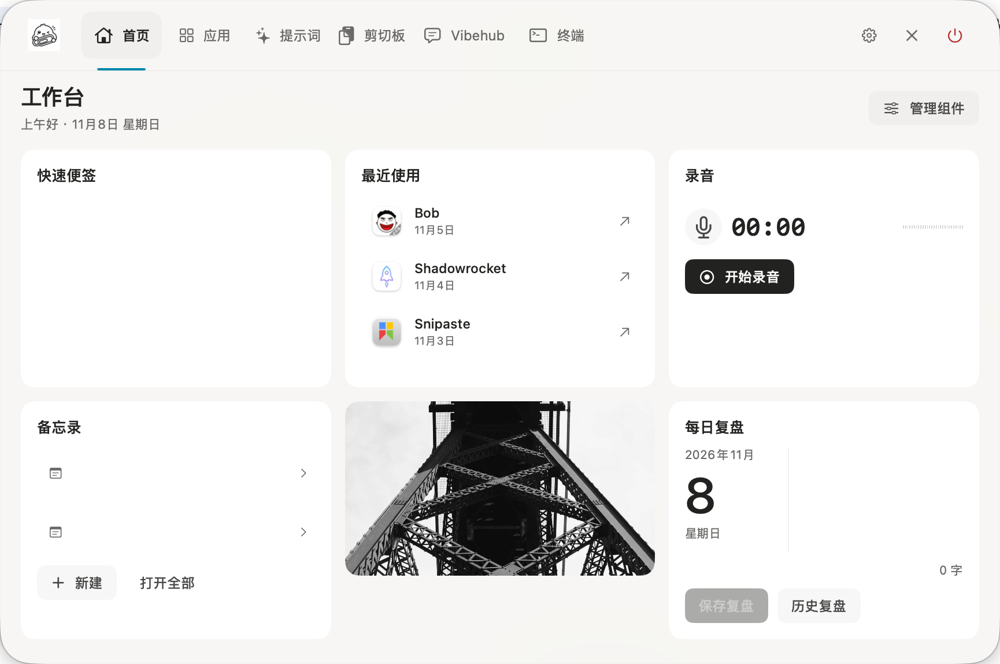
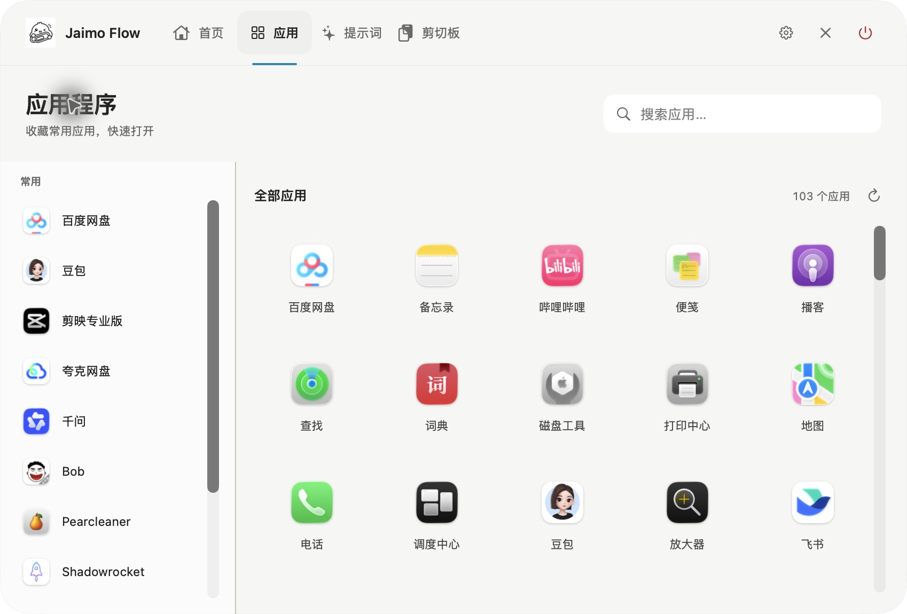

<p align="center">
  
</p>

<h1 align="center">Jaimo Flow</h1>

<p align="center">
  原生、本地优先的 macOS 个人工具站
</p>

<p align="center">
  <a href="https://github.com/Jaimo-so/Jaimo-Flow/releases/latest"></a>
  
  
  <a href="LICENSE"></a>
</p>

<p align="center">
  <a href="https://github.com/Jaimo-so/Jaimo-Flow/releases/latest"><strong>下载最新版本</strong></a>
</p>

<p align="center">
  
</p>

Jaimo Flow 把常用的本机操作收进一个由 `⌥Space` 直接唤起的工具站，并提供位于菜单栏中央的刘海式悬停入口及文件中转功能。首页提供时间、快速便签、多条备忘录、本地录音、镜子和最近应用；应用页集中搜索、收藏并启动本机应用；提示词与剪切板页面负责管理长期复用的模板和临时内容；Vibehub 收集 Vibe Coding 话术，并可通过自己配置的模型 API 辅助分类和补全。

所有剪切板记录、图片、提示词、便签、备忘录、镜子封面、中转文件和录音均保存在本机。应用无需账户，不依赖云同步，不包含 Electron 或 AI 运行时；界面和核心能力使用 Swift、SwiftUI、AppKit 与 macOS 系统框架实现，内置终端使用 WebView 呈现。

> 当前版本：`0.9.0`。支持 macOS 13 或更高版本，仅提供 Apple Silicon（M1/M2/M3/M4 及后续芯片）安装包，不提供 Intel（x86_64）版本。

## 0.9.0 版本更新

新增黑色主题、截图与贴图扩展，以及截图文字识别和翻译扩展。完整变更与安装说明见 [0.9.0 发布说明](docs/releases/v0.9.0.md)。

## 0.8.0 版本更新

新增内置终端，可在工具站中运行交互式 shell，切换页面时保留会话和输出，并支持关闭及重新打开终端。完整变更与安装说明见 [0.8.0 发布说明](docs/releases/v0.8.0.md)。

## 0.7.0 版本更新

0.7.0 新增顶部刘海式悬停入口、每日复盘、Vibehub 模块及话术整理 Agent，可直接从上方 GitHub Releases 下载。完整变更与升级说明见 [0.7.0 发布说明](docs/releases/v0.7.0.md)。

- 顶部中央刘海：适配无物理刘海的 MacBook Air，鼠标移入展开、移出收起，配有开关动画；移除旧菜单栏图标与侧边悬浮球。
- 每日复盘：按日期记录内容，支持编辑当日内容、保存和历史查看。
- 完整保留笔记：快速便签和备忘录在关闭编辑界面、离开首页、隐藏或退出时保存；失败时保留内容并允许重试，改进连续输入和中文输入法组合文本的保持。
- 独立的话术库：按用途分类，以笔记形式保存完整原文、标签、适用场景、术语定义与含义，支持搜索、收藏和完整复制。
- 自己配置模型 API：填写接口地址、模型名称和 API Key，接入 OpenAI 兼容的 Chat Completions 服务；API Key 保存在 macOS 钥匙串。
- 先预览再保存：Agent 补全后可逐项修改，只有手动确认才写入话术库。
- 关闭直接清空：未保存的输入和预览不保存草稿，关闭、取消整理或隐藏窗口后清空，再次打开从空白输入开始。

完整操作流程、分类说明和哈希路由示例见下方“Vibehub 话术库”。

## 产品展示

首页截图来自 Jaimo Flow `0.8.0`，便签和备忘录的个人内容已遮盖；应用页截图来自 `0.6.0`，于 2026 年 9 月 27 日实机截取。

| 可组合首页 | 本机应用启动台 |
| --- | --- |
|  |  |

首页组件进入管理模式后可直接拖拽排序、隐藏，并在小型、中型和大型档位之间调整。录音只在用户主动开始后请求麦克风权限，文件保存在本机；镜子组件显示照片或摄像头画面，照片固定以 16:9 居中裁剪；偏好设置中的“首页照片”支持随机换图或选择本地照片，随机照片联网获取后保存在本机。点击照片打开摄像头，再次点击实时画面关闭，摄像头画面不录制、不保存、不上传。应用启动台扫描本机应用目录，收藏和最近启动记录同样只保存在本机。

产品设计语言记录在 `DESIGN.md`。`jaimo-island-handoff-spec.md` 保留了 Jaimo Flow 工具站早期交互方案和设计演进；旧版剪贴板视图的视觉与实现资料继续保留在 `clipflow-app.html` 和 `clipflow-handoff-spec.md`，用于追踪兼容行为。

## 下载与安装

1. 从 [GitHub Releases](https://github.com/Jaimo-so/Jaimo-Flow/releases/latest) 下载名称以 `-macOS-Apple-Silicon.dmg` 结尾的安装包。
2. 双击打开 DMG。
3. 将 `Jaimo Flow.app` 拖到镜像中的 `Applications` 快捷入口。
4. 从“应用程序”文件夹启动 Jaimo Flow。启动后会在屏幕顶部菜单栏中央显示黑色刘海入口。

当前公开安装包使用临时代码签名，尚未使用 Apple Developer ID 公证。其他 Mac 首次打开时可能被 Gatekeeper 阻止；请前往“系统设置 → 隐私与安全性”，在安全提示旁选择“仍要打开”，随后确认一次。不要从非本仓库 Release 的第三方地址下载安装包。

如需验证下载是否完整，将同一 Release 中的 `.dmg` 与 `.dmg.sha256` 放在同一目录后执行：

```bash
shasum -a 256 -c Jaimo-Flow-0.8.0-macOS-Apple-Silicon.dmg.sha256
```

## 当前能力

- 使用 `⌥Space` 从隐藏态直接打开完整工具站，不经过额外的中间界面；再次触发快捷键、点击窗口外部、点击关闭按钮或按 `Escape` 可隐藏
- 顶部刘海支持无刘海的 MacBook Air，在菜单栏中央固定显示；鼠标停留 120ms 展开工具站，移出入口及内容区 300ms 后收起，快速返回会取消收起；展开使用 280ms 淡入与轻微缩放位移，收起使用 200ms 反向动效
- 将多个文件或文件夹拖到刘海可打开文件中转站；中转站保存独立本地副本，可再次拖出、定位、移除或二次确认清空
- 首页包含时间、快速便签、多条备忘录、本地录音、镜子和最近使用应用；管理模式支持拖拽排序、隐藏、恢复，并可用尺寸菜单或右下角手柄调整尺寸档位
- 备忘录支持多条内容、标题、正文、置顶和删除，不与快速便签或剪切板历史混存；备忘录和快速便签编辑期间只保留内存修改，关闭编辑界面、离开首页、隐藏窗口或正常退出时统一保存，备忘录列表内切换记录不会提前保存；保存失败保留编辑内容并支持重试
- 录音支持开始、暂停、继续、完成、实时音量反馈；完成后可在组件中播放最近一条，或打开「历史录音」搜索、播放、重命名、复制路径、在访达中显示和二次确认删除；M4A 文件只保存在本机 Application Support 目录
- 镜子支持 16:9 横图和手机竖图，组件宽高比跟随照片；正常状态只显示照片或水平镜像的本机实时画面，点击即可切换，照片管理位于右键菜单
- 应用页扫描 `/Applications`、`/System/Applications` 和 `~/Applications`，支持搜索、收藏、启动和最近使用记录
- 每 0.4 秒读取 `NSPasteboard.changeCount`，自动记录文字、代码、HTTP(S) 链接和图片
- 支持直接复制的 PNG/JPEG 像素数据，也支持从 Finder、飞书等应用复制 JPG/JPEG、PNG 等本地图片文件；文件引用会读取真实图片内容，不会误存为文件图标
- 设置页支持检查更新；发现 GitHub Release 新版本后，可一键下载、校验、安装并自动重新启动
- 使用 Carbon 注册全局 `⌥Space`，通过不激活原应用的浮动 `NSPanel` 展示历史
- 支持搜索、全部/文字/图片/链接/收藏分类、键盘导航、复制回剪贴板、收藏和删除
- 剪切板内提供独立的 API Key 分组，支持按名称搜索、新建、编辑、复制和确认删除 API Key 或密码；内容默认遮盖，保存在本机 macOS 钥匙串中，不受历史数量上限和清空历史影响
- 内置独立的本地提示词库，支持分组、搜索、收藏、新建、编辑、删除和使用次数记录
- Vibehub 独立保存 Vibe Coding 话术，支持笔记式编辑、用途分类、标签、适用场景、术语与含义、搜索、收藏、完整复制和自动保存；首次进入时提供哈希路由示例，并可配置模型 API，让 Agent 整理新话术，先预览修改再手动保存
- 内置交互式终端，切换页面时保留会话和输出，支持关闭当前会话并重新打开
- 可将文字、代码或链接历史保存为提示词；使用 `{{变量名}}` 定义调用时填写的模板变量
- 长文本预览按片段渐进渲染，首屏只排版开头内容，滚动到底部后继续加载后续片段
- 连续相同内容按 SHA-256 去重；自身写回剪贴板产生的 change count 会被忽略
- 历史上限为 150 条，超出后淘汰最旧的非收藏项，收藏项保留
- SQLite 只保存元数据和图片路径；图片文件独立保存在本机 Application Support 目录
- 默认排除 1Password、钥匙串访问和终端，可在 `⌘,` 偏好设置中移除
- 清空历史需要在 8 秒内进行第二次确认
- 跟随系统浅色/深色外观，并支持系统“减弱动态效果”设置

## 使用说明

启动后默认在内置屏幕顶部、菜单栏中央显示黑色刘海；没有内置屏幕时使用主屏幕。MacBook Air M1 等无物理刘海的机型同样可用，入口贴住屏幕上边缘。鼠标移入入口后展开工具站，移到工具站内部继续操作，移出整个入口和内容区后自动收起。快速划过不会立即展开，短暂移出再返回会取消收起。设置、确认对话框和文件拖动期间暂缓自动收起，避免中断当前操作；主动关闭后需先移出刘海再移回，才会再次展开。

刘海右键菜单可打开工具站、文件中转站、偏好设置、隐藏顶部刘海或退出 Jaimo Flow；也可直接将文件或文件夹拖到刘海打开中转站。原菜单栏图标入口已移除，顶部刘海是唯一常驻可视入口；`⌥Space` 可继续显示或隐藏完整工具站，检查更新位于偏好设置中。刘海入口的显隐设置会保留，独立于旧版悬浮球设置。开启系统“减弱动态效果”时取消窗口缩放与位移。

快捷键：

- `⌥Space`：直接显示或隐藏完整工具站
- `↑` / `↓`：移动选中项
- `↵`：复制选中项到系统剪贴板
- `⌘F`：聚焦搜索
- `⌘1` / `⌘2` / `⌘3` / `⌘4` / `⌘5`：切换首页 / 应用 / 提示词 / 剪切板 / Vibehub
- `⌘N`：新建提示词；在剪切板 API Key 分组中新建 API Key / 密码；在 Vibehub 中新建话术
- `⌘E`：编辑选中的提示词或 API Key / 密码
- `⌘S`：切换收藏；在 API Key / 密码编辑界面保存；在 Vibehub 中立即保存话术
- `⌘⌫`：删除选中项
- `⌘,`：打开或关闭偏好设置
- `⌘Q`：退出 Jaimo Flow，结束后台进程
- `ESC`：先清空搜索，再关闭面板

开机自动启动需要应用位于 `/Applications`。在 Jaimo Flow 偏好设置中开启相应选项即可。

### Vibehub 话术库

从顶部导航打开 Vibehub，点击“新建话术”，填写标题与完整话术原文。每条话术还可记录标签、适用场景和术语与含义；字段分别保存，不缩写原文、定义或意义。“复制话术”只复制完整话术原文，可直接发送给编程 Agent。

用途分类包括路由与导航、界面与布局、交互与动效、数据与接口、调试与测试、部署与工程、未分类。点击“识别分类”会按标题和原文的本地关键词规则选择分类；可以随时手动调整，继续编辑原文不会覆盖手动分类。分类筛选可与搜索同时使用，搜索覆盖标题、原文、标签、场景、含义和分类。收藏的话术排在列表前面。

首次打开时内置“页面切换与哈希路由”，完整话术为：“给各个页面加上哈希路由，点击切换时网址同步变化，并支持刷新和浏览器前进后退。”该示例归入“路由与导航”，并保留以下说明：

- 适用场景：多页面网站或 Web 应用，需要切换页面时同步网址，刷新后保留当前页面，并支持浏览器前进和后退。
- 术语与含义：哈希路由（Hash Routing）使用网址中 `#` 后面的片段表示当前页面，例如 `#/home` 和 `#/settings`。切换页面时更新这个片段，刷新时根据它恢复页面，浏览器前进和后退时同步显示对应页面。

编辑后自动保存；切换页面、隐藏或退出工具站时也会立即保存。删除需要点击“删除”后再次点击“确认删除”，删除示例后不会在重启时重新添加。

Vibehub 内置话术整理 Agent，使用自己配置的模型 API：

1. 点击“Agent 设置”，填写服务商提供的接口地址、模型名称和 API Key。当前支持 OpenAI 兼容的 Chat Completions 接口，地址可填写到 `/v1` 或完整的 `/chat/completions`。远程地址使用 HTTPS，本机模型服务可使用 HTTP。
2. 默认启用 JSON 模式。若服务不支持该参数，可关闭“接口支持 JSON 模式”；应用仍会校验返回字段和分类。
3. 点击“Agent 整理”，粘贴新学的话术，点击“整理并预览”，或按 `⌘Return`。Agent 会填写标题、用途分类、标签、适用场景和术语与含义；应用原样保留用户输入的原文，包括空格、换行和段落。
4. 补全完成后进入“预览补全内容”，完整显示所有字段。标题、分类、标签、话术原文、适用场景和术语与含义均可修改。预览中的长文可滚动查看，不折叠、压缩或截断定义和意义；也可“返回输入”，修改原文后重新整理，或“继续预览”保留的结果。
5. 确认后点击“保存到 Vibehub”，或在预览界面按 `⌘Return`，才将最新修改写入话术库，并打开新记录。整理完成不会将未确认的预览加入话术库。选择“关闭”、按 Escape 关闭话术面板或隐藏窗口时，直接清空本次输入和补全内容，不保存草稿；取消整理也会清空。调用失败时可在当前面板中保留输入并重试；本地保存失败保留可编辑预览，继续修改后可再次点击保存，无需重新请求模型，也不会重复创建记录。

未保存的输入和预览修改仅在当前整理流程的内存中保留，关闭后清空，重开应用不会恢复；旧版本暂存的草稿也会清除。关闭 Agent 设置会返回当前输入或预览，便于继续本次整理。模型接口地址、模型名称和 JSON 模式保存在本机偏好设置中；API Key 使用独立的 macOS 钥匙串服务保存，不写入话术文件或偏好设置，也不混入剪切板内的 API Key 分组。修改设置时 API Key 留空可沿用已有密钥。

## 隐私与本机数据

Jaimo Flow 不自动上传剪贴板内容，不要求应用账户，也没有云同步。链接首版不抓取网页标题，避免让复制行为产生隐式网络请求。“检查更新”功能会访问本仓库的 GitHub Release API 和下载安装包。用户主动点击 Vibehub 的“整理并预览”时，该次输入的话术和整理规则会发送到用户配置的模型服务；完整话术库、备忘录和剪贴板历史不会附带发送。整理结果先在本机预览，确认保存后进入话术库，模型服务按用户自己的 API 账户处理请求。

为保证从旧版 ClipFlow 升级后不丢失记录，应用继续使用原有的内部应用标识 `com.clipflow.mac` 和数据目录：

```text
~/Library/Application Support/ClipFlow/
├── ClipFlow.sqlite3      # 剪贴板历史、提示词、应用启动记录等本机数据
├── Images/               # 剪切板图片
├── Recordings/           # 用户主动创建的 M4A 录音
├── Memos/memos.json      # 多条备忘录
├── VibeHub/phrases.json  # Vibe Coding 话术、分类与笔记
├── Mirror/               # 镜子未打开时显示的封面照片
└── FileRelay/            # 文件中转副本与索引
```

API Key 分组的内容保存在 macOS 钥匙串中，不写入上述 SQLite 数据库；从该分组复制时不会再次收录为普通剪贴板历史。需要移除已保存的密钥或密码时，请在 API Key 分组中删除对应条目。

删除应用不会自动删除上述本地数据。偏好设置中的“清空历史”只删除剪贴板历史，不会删除提示词库；如需彻底移除全部数据，先在 API Key 分组中删除已保存的密钥和密码，再退出应用并删除该目录。

## 应用内更新

应用每 24 小时最多自动检查一次，也可以在偏好设置或菜单栏中手动检查。更新源由 `Resources/Info.plist` 的 `ClipFlowUpdateRepositoryOwner` 和 `ClipFlowUpdateRepositoryName` 定义，当前为 `Jaimo-so/Jaimo-Flow`。

每个 GitHub Release 需要满足以下契约，否则应用会拒绝一键安装：

- Release 标签使用可比较版本号，例如 `v0.3.1`
- Apple Silicon 安装包名称以 `-macOS-Apple-Silicon.dmg` 结尾
- Release 资产包含 GitHub 提供的 `sha256:` digest，或同时上传与 DMG 同名并追加 `.sha256` 的校验文件
- DMG 根目录包含 `Jaimo Flow.app`，并提供在 Finder 中隐藏的 `Jaimo clip.app` 兼容入口，供 0.3.x–0.5.0 更新器安装；新版更新器也能识别 `Jaimo clip.app` 和 `ClipFlow.app`
- 应用标识必须为 `com.clipflow.mac`
- 应用版本必须与 Release 标签一致，可执行文件必须包含 `arm64` 架构，代码签名必须有效

下载使用 HTTPS；安装前会验证 SHA-256、应用标识、版本、架构和代码签名。更新助手会先备份当前应用，替换失败时恢复旧版本，成功后重新启动 Jaimo Flow。若已使用 Developer ID 签名，候选版本还必须使用相同的 Team Identifier。

## 从源码构建

要求：

- macOS 13 或更高版本
- Apple Silicon Mac
- 至少一个与当前 Swift 编译器兼容的 macOS SDK（Xcode 或 Command Line Tools 提供）
- Swift 5.9 或更高版本

构建应用：

```bash
./Scripts/build-app.sh
```

构建脚本只使用 Swift Package Manager 和 macOS 系统框架，并在 `build/Jaimo Flow.buildbundle` 生成一个临时签名的应用包。构建产物不直接打开；安装后从 `/Applications/Jaimo Flow.app` 运行，避免出现重复的应用入口。脚本会先验证系统默认 SDK；如果 Command Line Tools 中的 Swift 编译器与默认 SDK 版本不一致，会自动选择机器上已安装的兼容 SDK。SDK 只决定编译时使用的系统接口，最低运行版本仍由 `arm64-apple-macosx13.0` 构建目标决定。

运行开发期自检：

```bash
./Scripts/run-self-test.sh
./Scripts/run-credential-self-test.sh
./Scripts/run-memo-self-test.sh
./Scripts/run-recorder-self-test.sh
./Scripts/run-vibehub-self-test.sh
./Scripts/run-vibehub-agent-self-test.sh
```

API Key 自检使用独立的临时钥匙串服务标识和测试剪贴板，完成后删除测试条目，不操作用户保存的密钥。

备忘录自检验证备忘录与快速便签编辑、停顿和切换记录期间不保存，关闭时保存最新完整内容，保存失败后保留内容并重试，以及创建、重复调用和存储兼容行为。录音自检验证历史列表按时间排序、按名称搜索、重命名与删除，使用临时目录，不触及用户本机录音。Vibehub 自检验证分类、搜索、长文保存和复制；Agent 自检使用模拟模型响应，验证接口配置、可编辑预览、关闭清空、手动保存和失败重试，不调用真实模型服务。

生成可下载的 macOS 安装镜像：

```bash
./Scripts/package-dmg.sh
```

安装包名称自动包含 `Resources/Info.plist` 中的当前版本号，例如 `dist/Jaimo-Flow-0.8.0-macOS-Apple-Silicon.dmg`。配套的 `.sha256` 文件用于校验下载文件是否完整。

如果更换了 `Resources/AppLogo.png`，重新生成 macOS 图标：

```bash
CLANG_MODULE_CACHE_PATH="$PWD/.build/module-cache-icon" \
swift Scripts/generate-icon.swift Resources/AppLogo.png Resources/AppIcon.icns
```

## 正式签名与公证

未配置 Apple Developer ID 时，构建脚本使用临时签名。如果本机已安装 Developer ID Application 证书，可以指定证书名称生成带强化运行时签名的应用：

```bash
CLIPFLOW_SIGN_IDENTITY="Developer ID Application: 你的名称 (TEAMID)" ./Scripts/package-dmg.sh
```

要让普通用户无需额外确认即可打开，从互联网发布前还需要使用 Apple Developer 账户对 DMG 进行公证并装订公证票据。

三者意义不同：

- 临时签名只保证应用包内部在构建后没有变化
- Developer ID 签名确认开发者身份
- Apple 公证表示 Apple 已扫描该发布文件，并为 Gatekeeper 提供可验证票据

## 项目结构

```text
Sources/ClipFlow/          macOS 主应用、界面、剪贴板监听和更新管理
Sources/ClipFlowKit/       数据模型、分类、SQLite 存储和 Release 解析
Sources/ClipFlowUpdater/   独立更新助手，负责安全替换与失败回滚
Sources/CSQLite/           SQLite 系统库桥接
Tests/ClipFlowSelfTest/    可直接运行的核心自检
Tests/ClipFlowMemoSelfTest/  备忘录创建、存储兼容与重复调用自检
Tests/ClipFlowRecorderSelfTest/  录音历史列表、搜索、重命名与删除自检
Tests/ClipFlowVibeHubSelfTest/  话术库分类、保存、搜索与复制自检
Tests/ClipFlowVibeHubAgentSelfTest/  模型接口、预览确认与关闭清空自检
Resources/                 Info.plist、原始 Logo 和 AppIcon.icns
docs/images/               README 产品展示图与真实界面截图
Scripts/                   图标生成、应用构建和 DMG 打包脚本
DESIGN.md                  当前工具站设计语言
jaimo-island-handoff-spec.md  工具站早期交互方案与设计演进记录
clipflow-app.html          旧版剪贴板交互原型
clipflow-handoff-spec.md   旧版剪贴板实现契约与兼容说明
```

Swift Package 内部 target 仍沿用 `ClipFlow` 命名，这是为保持已有构建结构和升级兼容；用户可见品牌均为 `Jaimo Flow`。

## 参与贡献

欢迎通过 Issue 报告可复现的问题或提出轻量化改进建议。提交代码前请运行自检和 `Scripts/package-dmg.sh`，并确保没有提交 `.build/`、`build/`、`dist/`、证书、令牌或本机剪贴板数据。

## 开源许可

本项目使用 [MIT License](LICENSE)。


### 截图与贴图扩展

在「偏好设置 → 扩展」中安装并启动「截图与贴图」。默认按 `Control + Option + A` 选择截图区域，使用工具栏完成标注后按回车或点击对勾复制图片，可直接粘贴到聊天或其他应用；也可点击“另存为 PNG”选择位置保存标注后的截图。默认按 `Control + Option + P` 将剪贴板中的图片贴在屏幕上。点击设置中的截图或贴图快捷键按钮，再按下新的组合键即可自定义；按 Esc 取消。贴图可以拖动，双击关闭，右键可复制图片或关闭贴图。设置中还提供停止、启动和卸载操作。扩展会在下次启动应用时恢复此前的运行状态和快捷键。

首次使用截图时，请按 macOS 提示授予屏幕录制权限；如果快捷键被其他应用占用，设置中会显示启动错误。截图选择时按 Esc 可取消。

目前这是随应用内置的首个扩展，设置中的安装控制其启用状态；尚不支持导入或运行独立开发的第三方扩展包。

截图界面支持拖动选区和控制点调整范围，提供矩形、箭头、画笔、荧光笔、马赛克、文字、撤销、重做、取消、贴图和复制。鼠标附近的放大镜显示像素与颜色，按 C 复制颜色，按 Shift 切换 RGB 和 HEX。

### 截图识别与翻译扩展

在「偏好设置 → 识别与翻译」中安装并启动。按 `Control + Option + S` 框选截图，完成选区后点击对勾或按回车识别并翻译；也可在扩展窗口打开图片、读取剪贴板或直接输入文字，选择目标语言并复制译文。历史记录保存在本机，可在窗口内查看或清空。扩展的运行状态会在下次启动时恢复。

识别使用 macOS Vision，翻译使用 macOS 系统翻译，要求 macOS 15 或更高版本；首次使用可能需要下载系统语言资源。截图需要授予 Jaimo Flow 屏幕录制权限。扩展不会自动清除历史记录，卸载后如需清除可先在历史界面操作。
